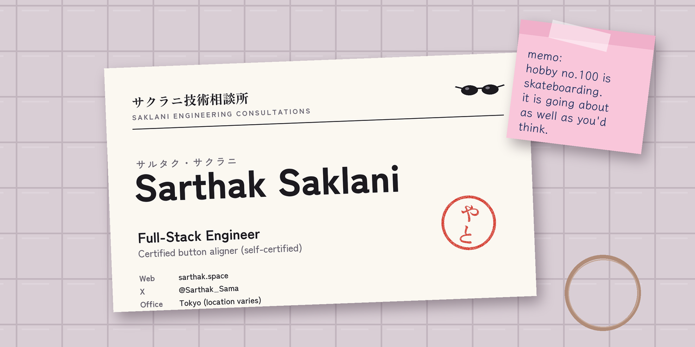
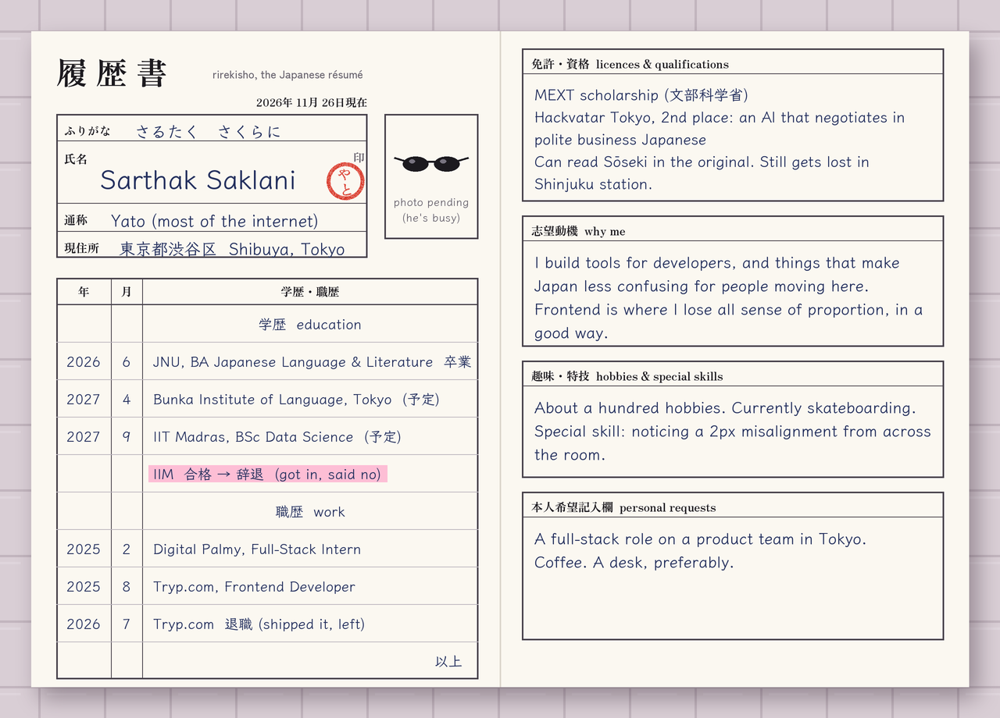
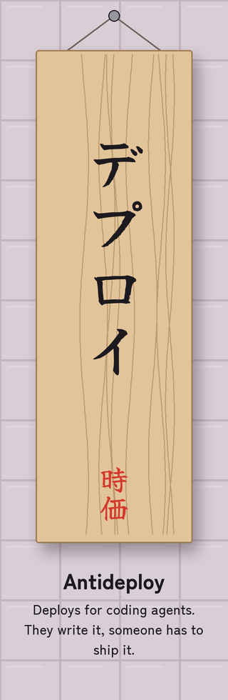
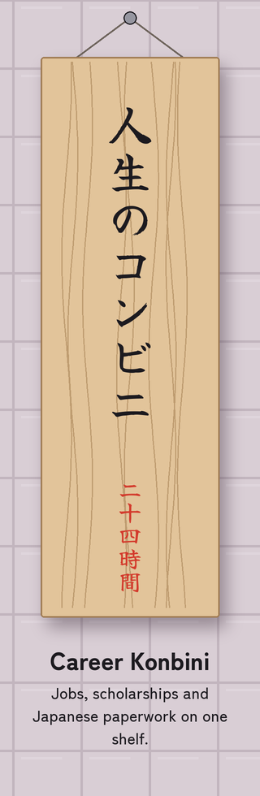
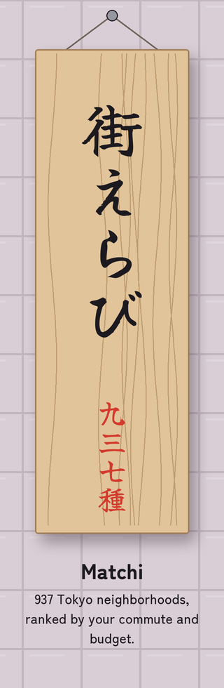
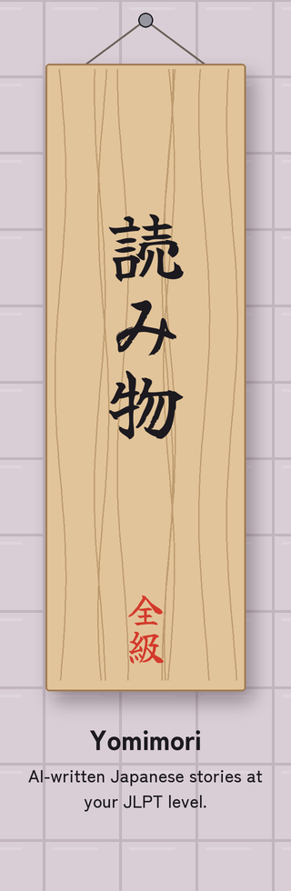
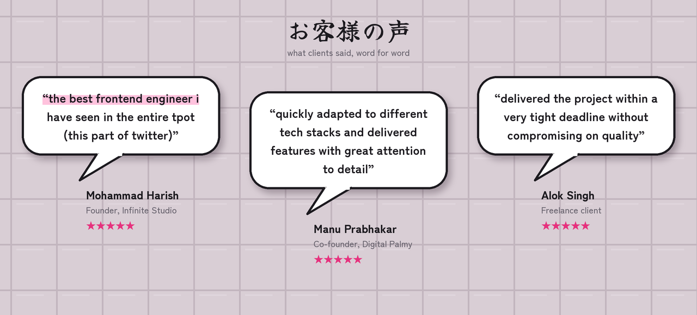

  
  
  

 

Hi, I'm Sarthak. Yato on most of the internet.

I'm a full-stack engineer in Tokyo. I build tools for developers, and things that make Japan a little less confusing for people moving here. Japan runs on paperwork, so here's mine.

 

  

 

 

