  
  
  
  

 

A full-stack engineer who moved from India to Tokyo on a MEXT scholarship. He studied Japanese literature at JNU and data science at IIT Madras, got into IIM, and turned it down to come here.

He builds tools for developers, and for people learning Japanese or finding their way to Japan. Most episodes end with something getting deployed.

 

  
  
  
  
  
  

| CH | Episode | Synopsis | Cast |
|:--:|:--|:--|:--|
| 01 | [**Antideploy**](https://antideploy.com) | A deploy platform built for coding agents. The main arc. | — |
| 02 | [**Matchi**](https://github.com/Sarthak-Sama/matchi) · [▶ live](https://matchi-web-ten.vercel.app) | Scores and ranks 937 Tokyo neighborhoods against your commute, budget and lifestyle. | TypeScript · Next.js · Fastify · PostGIS |
| 03 | [**Yomimori**](https://github.com/Sarthak-Sama/Yomimori) | AI-generated Japanese stories at your JLPT level, with furigana and a built-in dictionary. | React · Express · MongoDB · Gemini |
| 04 | [**JapanOuts**](https://github.com/Sarthak-Sama/japanauts) | A Japanese learning companion: lessons, reading, daily vocab and recommendations. | Next.js · TypeScript · MongoDB · Gemini |
| 05 | [**CodeHours**](https://github.com/Sarthak-Sama/CodeHours) | Tracks your coding time with a VS Code extension, a web dashboard and an embeddable live widget. | VS Code API · React · Node |
| 06 | **Liveshot** | A screenshot backed by a preserved sandbox, with an agent that hunts the bug. *Daytona HackSprint Tokyo.* | Daytona · AI agents |
| OVA | **Hackvatar** | An AI avatar negotiation sim in polite business Japanese. 🥈 *2nd place, Hackvatar Tokyo.* | — |

 

  

 

  

  
  

 

<b>次回、第22話「内定」</b> · next time, Yato joins a Tokyo product team · hiring? <a href="https://x.com/Sarthak_Sama">X</a> · <a href="https://www.linkedin.com/in/sarthak-saklani-734b85235">LinkedIn</a> · <a href="https://sarthak.space">sarthak.space</a>

