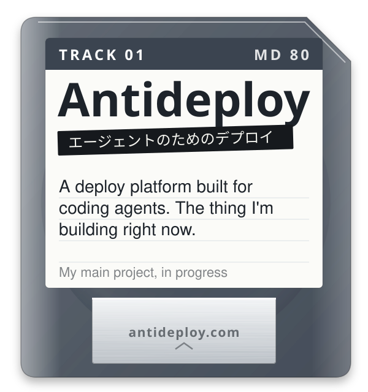
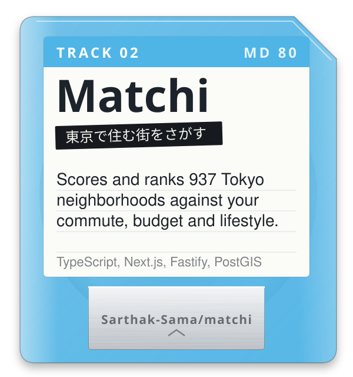
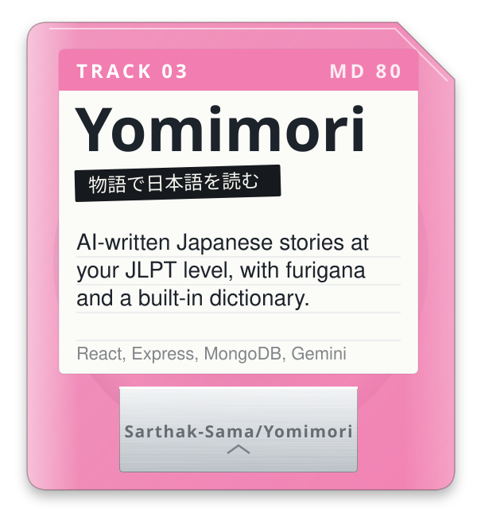
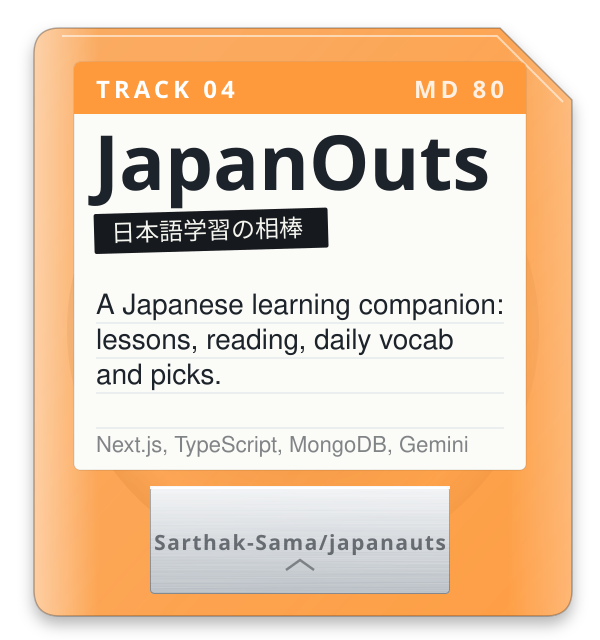
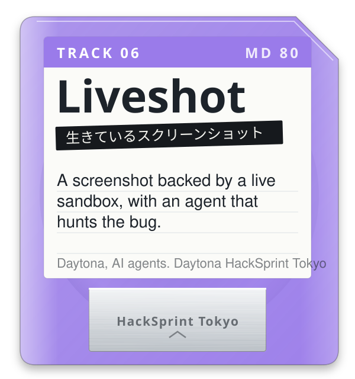
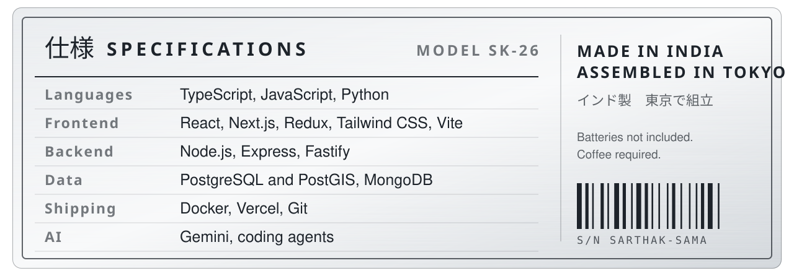

  &nbsp;
  &nbsp;
  

 

I'm a full-stack engineer in Tokyo. I moved here from India on a MEXT scholarship, after studying Japanese literature at JNU and data science at IIT Madras. I got into IIM and turned it down to come here.

I build tools for developers, and for people learning Japanese or finding their way to Japan. Right now that means **[Antideploy](https://antideploy.com)**, a deploy platform built for coding agents.

 

  
  
  
  
  
  

Matchi has a <a href="https://matchi-web-ten.vercel.app">live demo</a>. Bonus track: <b>Hackvatar</b>, an AI avatar negotiation sim in polite business Japanese, took 2nd place at Hackvatar Tokyo.

 

 

