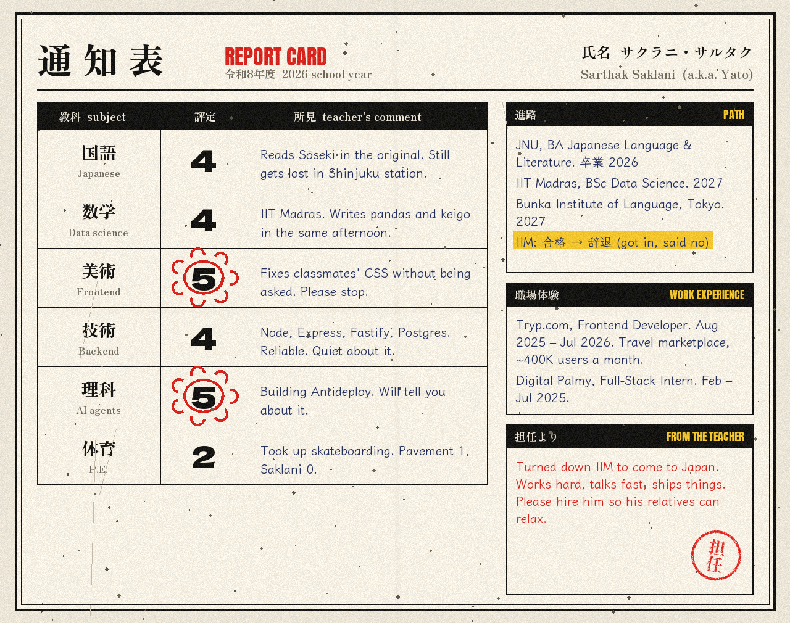
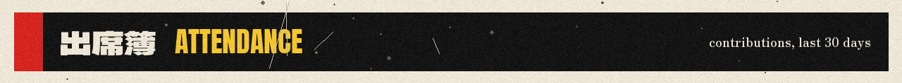
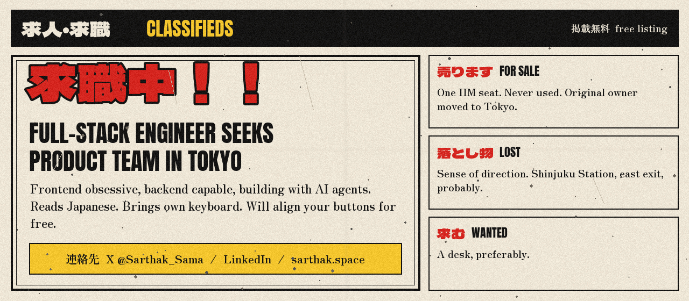

  
  
  

 

I'm Sarthak, Yato on most of the internet. A full-stack engineer in Tokyo, and the kind of frontend person who notices when your button is two pixels off and tries very hard to be normal about it.

I moved here from India on a MEXT scholarship. I studied Japanese literature at JNU, so I can read Sōseki in the original and still get lost inside Shinjuku station. I'm finishing a data science degree at IIT Madras too, so I write keigo and pandas, sometimes in the same afternoon. I got into IIM and turned it down. My relatives are still processing it.

Until this summer I owned the frontend of Tryp.com's travel marketplace, used by about 400K people a month. Now I'm building <a href="https://antideploy.com"><b>Antideploy</b></a>, a deploy platform for coding agents.

Off the keyboard I'm a man of a hundred hobbies. The latest is skateboarding. Tokyo's pavements have been very patient with me.

 

 

 

 

Halftone photos are prints by Utagawa Kuniyoshi and Katsushika Hokusai, public domain. The tiger is not him.

