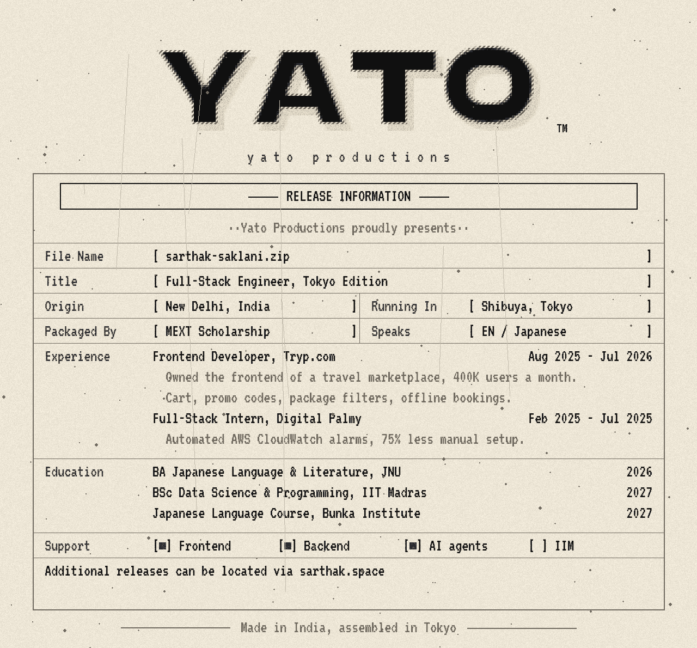
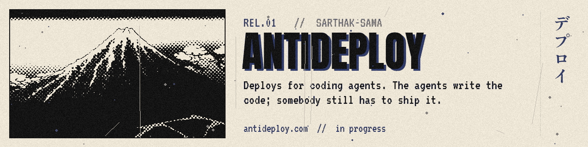
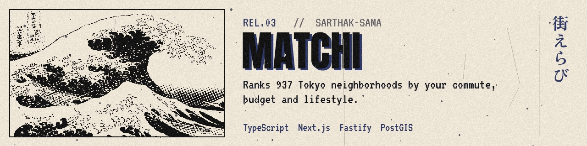
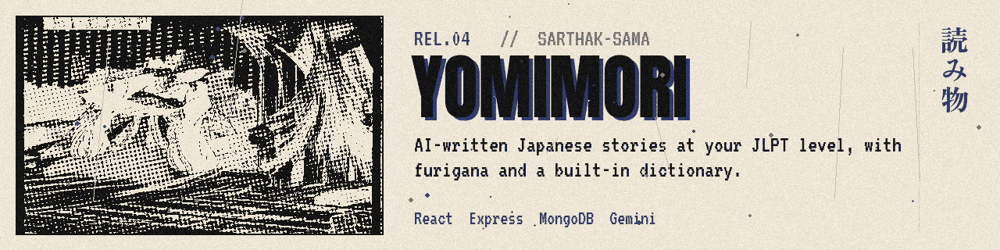
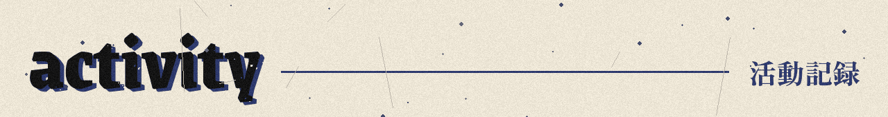
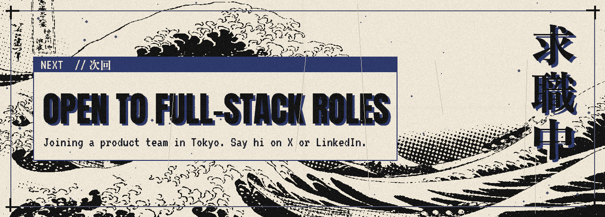

  
  
  

 

I'm Sarthak, Yato on most of the internet. A full-stack engineer in Tokyo, and the kind of frontend person who notices when your button is two pixels off and tries very hard to be normal about it.

I moved here from India on a MEXT scholarship. I studied Japanese literature at JNU, so I can read Sōseki in the original and still get lost inside Shinjuku station. I'm finishing a data science degree at IIT Madras too, so I write keigo and pandas, sometimes in the same afternoon. I got into IIM and turned it down. My relatives are still processing it.

Until this summer I owned the frontend of Tryp.com's travel marketplace, used by about 400K people a month. Now I'm building <a href="https://antideploy.com"><b>Antideploy</b></a>, a deploy platform for coding agents.

Off the keyboard I'm a man of a hundred hobbies. The latest is skateboarding. Tokyo's pavements have been very patient with me.

 

> [!NOTE]
> Will notice if your button is 2px off. Will say something.

 

 

 

Prints by Utagawa Kuniyoshi and Katsushika Hokusai, public domain.

