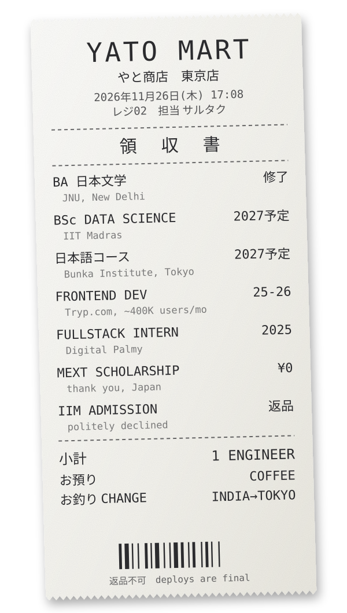

  &nbsp;
  &nbsp;
  

 

Hi, I'm Sarthak. Most of the internet knows me as Yato.

I'm a full-stack engineer in Tokyo, and frontend is where I lose all sense of proportion. If your button is two pixels off, I have already noticed, and I am trying very hard to be normal about it.

I came to Japan from India on a MEXT scholarship. Before that I studied Japanese literature at JNU, so I can read Sōseki in the original and still get lost inside Shinjuku station. I'm also finishing a data science degree at IIT Madras, so I can now write keigo and pandas, sometimes in the same afternoon. I also got into IIM and turned it down, which my relatives are still processing.

 

  
  &nbsp;
  

 

### What I like building

**Tools for developers.** Right now that's [**Antideploy**](https://antideploy.com), a deploy platform for coding agents. The agents write the code. Somebody still has to ship it.

**Things that make Japan less confusing.** Japan runs on paperwork, and I'm working on it. [Career Konbini](https://github.com/Sarthak-Sama/career-combini) puts jobs, scholarships and Japanese-format documents on one shelf. [Matchi](https://matchi-web-ten.vercel.app) ranks 937 Tokyo neighborhoods by your commute, budget and lifestyle, so you can pick one before you've signed a two-year lease. [Yomimori](https://github.com/Sarthak-Sama/Yomimori) writes Japanese stories at your JLPT level, with furigana.

**Interfaces that feel good to touch.** At [Tryp.com](https://tryp.com) I owned the frontend of the travel marketplace: the cart, the promo codes, a holiday-package filter with more interdependent rules than a Tokyo garbage calendar, and offline bookings for the moment your hotel confirmation matters and your signal doesn't. About 400K people a month used it.

**Anything with a deadline.** I once built an AI that negotiates in polite business Japanese, the hardest boss in any language. It took 2nd place at Hackvatar Tokyo.

Off the keyboard I'm a man of a hundred hobbies. The latest one is skateboarding, and Tokyo's pavements have been very patient with me.

 

 

